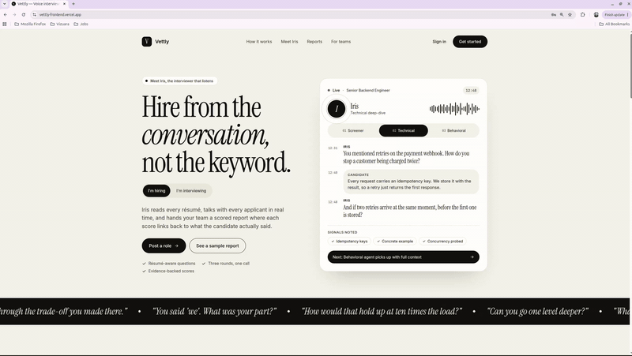
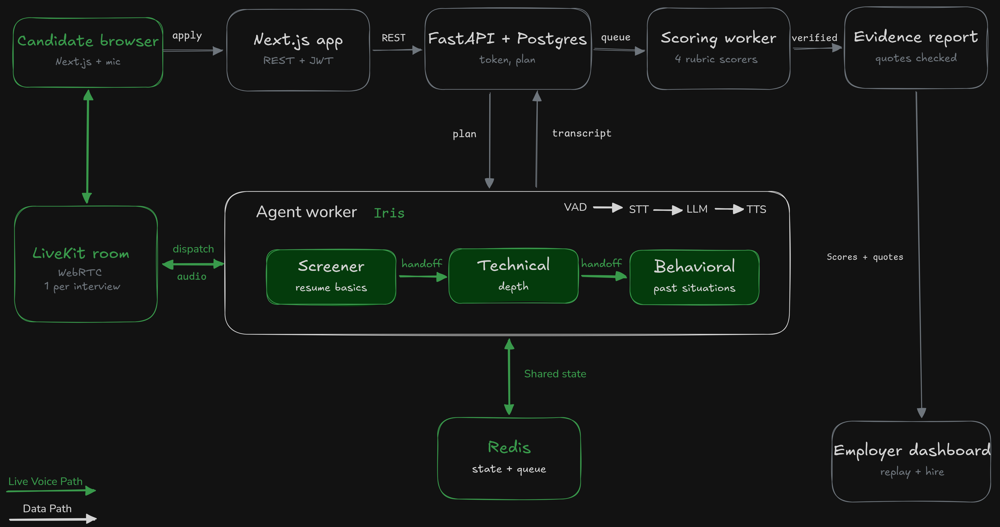

# Vettly

**Voice interviews, scored with evidence.**

Vettly is an AI voice interviewer. Candidates apply, upload a résumé, and take a live voice interview with **Iris**. Employers get a scored report where every score links back to something the candidate actually said.



**Live app:** https://vettly-frontend.vercel.app/
**Frontend repo:** https://github.com/prabhatsin/vettly_frontend

## What it does

- **Résumé-aware interviews:** questions are built from the candidate's résumé and the job description.
- **Three agents, one call:** a screener, a technical interviewer and a behavioral interviewer take turns on the same live call, passing context along so the candidate never repeats themselves.
- **Evidence-backed scoring:** after the call, each rubric criterion is scored with a quote from the transcript as evidence.
- **Employer view:** scores, quotes and a replay of the interview.

## How it works

1. A candidate applies to a job and uploads a résumé.
2. The candidate joins a LiveKit room. The backend issues a room token and an agent worker joins.
3. Iris runs the interview through the voice pipeline (VAD → STT → LLM → TTS), with turn detection and interruption handling.
4. The screener hands off to the technical agent, then to the behavioral agent, sharing state along the way. Live interview state is kept in Redis.
5. The transcript is saved, and a scoring job grades each rubric criterion with transcript quotes as evidence.
6. Employers open the report and the replay in the dashboard.

## Architecture



| Layer | Technology |
|---|---|
| Frontend | Next.js, React (separate repo) |
| API | FastAPI, SQLAlchemy, Alembic |
| Database | PostgreSQL |
| Live state and queue | Redis |
| Real-time voice | LiveKit (server and Agents framework) |
| Voice pipeline | [STT provider], [LLM provider], [TTS provider] |
| Deployment | [Railway for API and worker], Vercel for frontend |

## Repository layout

```
api/                 FastAPI backend (routers, services, repositories, models, migrations)
agent/               LiveKit agent worker (Iris and the three interview agents)
system-design/       Architecture diagrams
docker-compose.yml   Local Postgres, Redis and LiveKit
.env.example         Environment variable names (no secrets)
```

## Getting started

**Prerequisites:** Docker, Python 3.11+, and API keys for your STT, LLM and TTS providers.

1. Clone the repo and copy the environment template:

```
git clone https://github.com/prabhatsin/Vettly.git
cd Vettly
cp .env.example .env
```

2. Fill in `.env` with your own values (see the variables below).

3. Start Postgres, Redis and LiveKit:

```
docker compose up -d
```

4. Set up and run the API:

```
cd api
python3 -m venv api_venv
source api_venv/bin/activate
pip install -r requirements.txt
alembic upgrade head
uvicorn app.main:app --reload
```

The API runs on http://localhost:8000 and the docs are at http://localhost:8000/docs.

5. In a new terminal, run the API background worker (résumé parsing and scoring jobs):

```
cd api
source api_venv/bin/activate
python -m app.worker
```

6. In another terminal, run the agent worker:

```
cd agent
python3 -m venv agent_venv
source agent_venv/bin/activate
pip install -r requirements.txt
python3 interviewer.py dev
```

7. Run the frontend from its own repo and point it at the API:
https://github.com/prabhatsin/vettly_frontend

## Environment variables

Names only. See `.env.example` for the full list.

| Variable | Purpose |
|---|---|
| `DATABASE_URL` | PostgreSQL connection string |
| `REDIS_URL` | Redis connection string |
| `LIVEKIT_URL` | LiveKit server URL |
| `LIVEKIT_API_KEY` / `LIVEKIT_API_SECRET` | LiveKit credentials |
| `[JWT secret variable]` | Signs login tokens |
| `[STT / LLM / TTS API key variables]` | Voice and language providers |

Never commit your real `.env`.

## Design decisions

- **Handoff, not orchestrator, for the live call.** Only one agent speaks at a time, and control passes directly to the next one, so there is no relay delay on a voice call.
- **Orchestrator for scoring.** After the call, one coordinator sends the transcript to separate scorers, one per rubric criterion, and merges the results.
- **Redis for hot state, Postgres for records.** Live interview state lives in Redis so any worker can resume a session. Users, jobs, applications, transcripts and reports live in Postgres.
- **Class-based services and repositories.** Routes never write raw queries.

## Roadmap

- [ ] Long-term candidate memory across interviews
- [ ] Simulated-candidate eval suite with scoring-consistency checks
- [ ] Per-stage latency metrics and tracing


## Author

Built by [Prabhat Singh](https://github.com/prabhatsin).